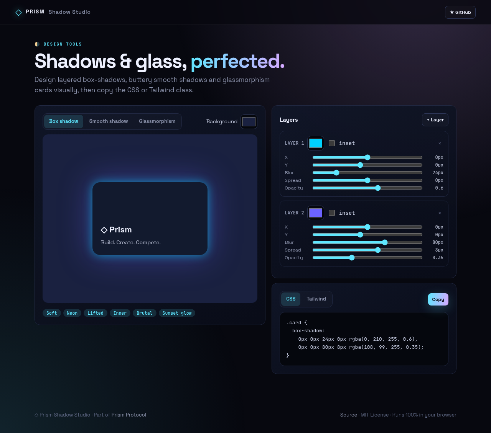
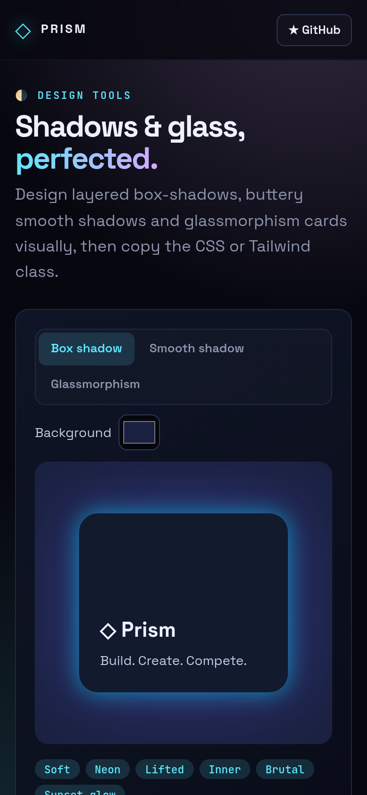

<!-- ═════════════ HEADER ═════════════ -->
<p align="center">
  
</p>

<p align="center">
  
</p>

<p align="center">
  <a href="https://github.com/krishyaa06/prism-shadow-studio/actions/workflows/ci.yml"></a>
  <a href="https://krishyaa06.github.io/prism-shadow-studio/"></a>
  
  
  <a href="LICENSE"></a>
</p>

<p align="center">
  
</p>


## ⚡ Overview

**Prism Shadow Studio** is a visual playground for depth in UI. Stack multiple box-shadow layers with full control, generate smooth multi-layer shadows from a few sliders, or design frosted-glass cards with backdrop blur. The preview updates live and the code is ready to paste.

## ✨ Features

- **Multi-layer box-shadow** editor: X, Y, blur, spread, color, opacity, inset
- **Smooth shadow** generator with doubling layers for natural falloff
- **Glassmorphism** with blur, saturation, tint, border and radius
- **Presets**: Soft, Neon, Lifted, Inner, Brutal, Sunset glow
- **CSS and Tailwind** output, custom stage background
- State saved locally

## 📸 Screenshots

<table>
  <tr>
    <td width="68%"></td>
    <td width="32%"></td>
  </tr>
</table>

## 🚀 Quick Start

**Use it online:** [https://krishyaa06.github.io/prism-shadow-studio/](https://krishyaa06.github.io/prism-shadow-studio/)

**Run locally:**

```bash
git clone https://github.com/krishyaa06/prism-shadow-studio.git
cd prism-shadow-studio
# open index.html in your browser, or serve it:
npx serve .
```

## 🛠️ Usage

- **Box shadow**: add layers and tune each one; toggle inset for inner shadows.
- **Smooth shadow**: pick layers, distance, blur and strength.
- **Glassmorphism**: adjust blur and opacity over the colorful background.
- Switch **CSS / Tailwind** and hit **Copy**.

## 📁 Project Structure

```text
prism-shadow-studio/
├── assets/
│   ├── logo.png
│   └── logo.svg
├── css/
│   ├── app.css
│   └── prism.css
├── js/
│   ├── app.js   # editor UI
│   ├── core.js   # shadow + glass CSS generation — tested in Node
│   └── prism.js
├── test/
│   └── core.test.js
├── .gitignore
├── LICENSE
├── README.md
├── index.html
└── package.json
```

## 🧪 Tests

```bash
npm test
```

Tests use the built-in `node:test` runner, so there is nothing to install. CI runs them on Node 20 and 22.

## 🤝 Contributing

1. Fork the repo and create a branch: `git checkout -b feature/my-idea`
2. Make your change and add a test in `test/`
3. Run `npm test` and open a Pull Request

## 🔷 Part of Prism Protocol

Prism Shadow Studio is one of the open-source tools built by [Prism Protocol](https://dc.gg/prismprotocol), a tech community where young builders learn, ship and compete together.

## 👤 Author

<table>
  <tr>
    <td align="center">
      <a href="https://github.com/krishyaa06"><br><b>Soumya Bhandare</b></a><br>
      <sub>Founder @ Prism Protocol</sub>
    </td>
    <td>
      <a href="https://dc.gg/prismprotocol"></a><br>
      <a href="https://instagram.com/prism_protocol_"></a><br>
      <a href="https://x.com/krishyaa06"></a>
    </td>
  </tr>
</table>

## 📄 License

Released under the [MIT License](LICENSE).

<p align="center">
  <b>If you like this project, consider giving it a ⭐</b><br>
  <sub>"Build. Create. Compete." · Made with ⚡ by Prism Protocol</sub>
</p>


